# Nauka o zbraních a střelivu

Nauka o zbraních je technická část zkoušky: jak se jmenují části zbraně, jak zbraň funguje, z čeho se skládá náboj a jak daleko může střela doletět. V testu je z této oblasti 5 otázek, vybíraných ze 130.

Hodně otázek se ptá **na obrázek**: „šipka ukazuje na…“, „číslem 3 je označena…“. Takové otázky se nedají naučit jen čtením, proto je v aplikaci procvičujte i s obrázky. Tahle kapitola vám dá pojmy, na kterých otázky stojí. U obrázkových otázek je pak stačí poznat.

Zdroj: soubor testových otázek MV ČR (oddíl IV). Text vysvětluje správné odpovědi vlastními slovy. Obrázky jsou převzaté ze souboru testových otázek MV ČR. Čísla a šipky v nich odpovídají testovým otázkám.

<!-- nova-strana -->

## 1. Hlaveň a vývrt

**Hlaveň** je součást palné nebo plynové zbraně, ve které se energie (u palné zbraně energie hořícího prachu) přemění na pohyb střely. Vodicí část vývrtu přitom vede střelu požadovaným směrem.

**Vývrt** je vnitřní dutina hlavně. Může být:

- **hladký**: typicky u brokových zbraní,
- **drážkovaný**: drážky ve tvaru šroubovice **roztočí střelu kolem její podélné osy**. Rotace střelu stabilizuje za letu,
- **polygonální**: místo drážek má profil složený z několika kruhových oblouků, jejichž středy leží mimo osu hlavně. Tvoří také šroubovici a střelu roztáčí podobně jako drážkovaný vývrt.

**Nábojová komora** je prostor v **zadní části vývrtu**, do kterého se po nabití zasune náboj. Rozměry a tvarem odpovídá příslušnému náboji. Výjimkou je revolver: tam komory nejsou součástí hlavně, ale **válce**.

**Ústí hlavně** je přední konec hlavně, kudy střela opouští zbraň.

**Vložná hlaveň** je hlaveň **menší ráže**, která se vkládá do vývrtu hlavně větší ráže. Z jedné zbraně tak lze střílet i menší ráží.

**Zahrdlení** je úprava ústí **brokové** hlavně, která ovlivňuje velikost a charakter **krytí**, tedy jak moc se broky po výstřelu rozptýlí (část 8).

Otázky: 720, 721, 722, 723, 724, 740, 756

## 2. Ráže

**Ráže** říká, pro jaké střelivo je zbraň určena. Není to jen jedno číslo:

- **u kulových zbraní** ji tvoří některé nebo všechny tyto údaje: smluvní velikost průměru vodicí části vývrtu, technický popis nábojové komory, technický popis použitelného náboje a doplňková označení. Proto existuje např. „7,62 × 39“ i „7,62 × 54 R“: stejný průměr, úplně jiné náboje,
- **u brokových zbraní** je to smluvní označení, ke kterému patří hlavně smluvní průměr vodicí části hlavně a jmenovitá nebo skutečná délka nábojnice.

**Broková ráže: menší číslo = větší ráže.** Ráže 12 je větší než ráže 20. Číslo historicky vyjadřuje, kolik olověných koulí o průměru hlavně by se dalo udělat z jedné libry olova. Čím víc koulí, tím menší průměr.

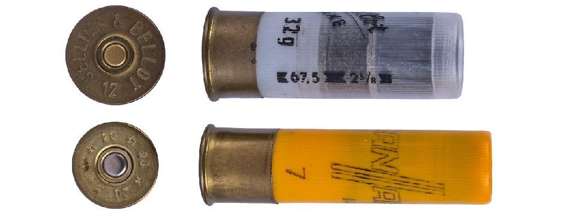

Otázky: 755, 757, 656

## 3. Části zbraně a jejich funkce

**Hlavní části zbraně** jsou ty, které zákon o zbraních a střelivu samostatně reguluje: zpravidla **hlaveň, závěr, tělo nebo rám** zbraně a u revolveru také **válec**. Pružiny, zásobník nebo mířidla hlavními částmi nejsou. V testu se to ptá na obrázku pistole: hlavní části jsou závěr, hlaveň a tělo, kdežto vratná pružina, zásobník a další díly ne.

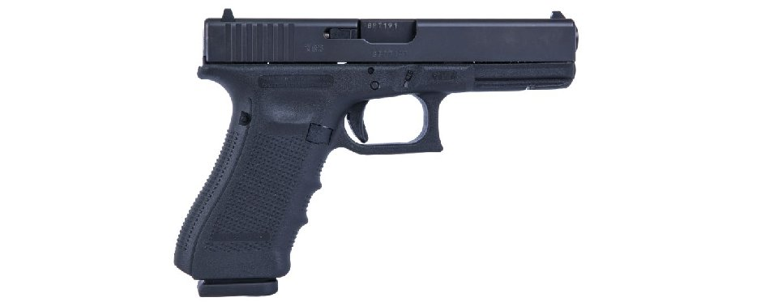

Další pojmy:

- **Závěr** uzavírá nábojovou komoru zezadu. U pistole bývá **kluzný pistolový závěr**, který se při výstřelu posouvá dozadu po těle zbraně.
- **Závorník** uzavírá nebo uzamyká nábojovou komoru u zbraní se **složeným** závěrovým mechanismem.
- **Nosič závorníku** při nabíjecím cyklu unáší závorník a zajišťuje jeho odemčení a uzamčení.
- **Uzamykací prvky** závěru: uzamykací ozuby, kuličky nebo válečky, kleština nebo závora.
- **Výhozné okénko** je otvor, kterým zbraň vyhazuje vystřelenou nábojnici, nebo náboj při vybíjení. Při kontrole zbraně se přes něj díváte do nábojové komory.
- **Bicí mechanismus** způsobí úder na zápalku (iniciační mechanismus). Může mít **vnější bicí kohout**, nebo **přímoběžný úderník**, který se pohybuje v ose hlavně a zvenku není vidět.
- **Spoušťové ústrojí** je mechanismus, který ovládá bicí mechanismus.
- **Spoušť** je součást, jejíž pohyb (typicky tlak prstu na jazýček spouště) přímo nebo zprostředkovaně aktivuje bicí mechanismus.
- **Lučík** je oblouk kolem spouště. Chrání ji proti nechtěnému zmáčknutí, například při manipulaci, ukládání do pouzdra nebo při zavěšení na popruh.
- **Pojistka** zajišťuje zbraň proti výstřelu. Některé pistole **vnější manuální pojistku nemají**. Pozor na otázku k obrázku rozložené pistole: správně je, že vnější manuální pojistka **není označena žádným z čísel**.
- **Automatická pojistka** u dlouhé brokové zbraně zajistí zbraň při každém sklopení hlavní. Před výstřelem je nutné ji **odjistit** ovládacím prvkem, například na hřbetu krku pažby.
- **Rám revolveru** je součást, na které jsou upevněny nebo pohyblivě uchyceny ostatní hlavní části a součásti revolveru.
- **Pažba** se opírá o rameno, **předpažbí** drží přední ruka.
- **Vratná (předsuvná) pružina** s vodítkem vrací závěr po výstřelu do přední polohy.

Otázky: 700, 701, 702, 703, 704, 705, 706, 707, 708, 709, 718, 719, 725, 726, 729, 730, 731, 732, 738, 739, 741

## 4. Uzamčený a neuzamčený závěr, funkční cykly

**Uzamčený závěr** je v okamžiku výstřelu **pevně spojen s hlavní**. Udrží tak vysoký tlak plynů uvnitř hlavně. **Neuzamčený (dynamický) závěr** s hlavní pevně spojen není a drží ho jen jeho hmotnost a pružina.

Jak se zbraň dobíjí:

- **Revolver:** spoušťový a bicí mechanismus se ovládá ručně. Revolver je až na výjimky **opakovací** zbraň.
- **Opakovací kulovnice s otočným odsuvným závěrem:** střelec ručně ovládá závěr klikou. **Otočením** se závěr uzamkne. V závěru bývá přímoběžný bicí mechanismus.
- **Opakovací brokovnice s posuvným předpažbím** („pumpa“): posunem předpažbí ovládáte závěr a nabíjení. Posunem dozadu se zároveň natáhne bicí mechanismus.
- **Samonabíjecí pistole s neuzamčeným závěrem:** dobíjí ji **zpětný ráz**, tedy tlak plynů na dno nábojnice, který tlačí závěr dozadu.
- **Samonabíjecí puška pro náboje středního výkonu** (např. .223 Remington, 7,62 × 39): využívá **tlak spalných plynů**. Buď se plyny odebírají z vývrtu a pohánějí nosič závorníku (uzamčené závěry), nebo tlačí na dno nábojnice (brzděné, tzv. polouzamčené závěry).

Otázky: 727, 728, 733, 734, 735, 736, 737

## 5. Druhy zbraní

**Krátké zbraně:**

- **Pistole:** krátká zbraň s pevnou nebo pohyblivou hlavní s nábojovou komorou. Může být jednoranová, opakovací nebo samonabíjecí, případně vícehlavňová.
- **Revolver:** krátká zbraň s pevnou hlavní a **otáčivým válcem** s nábojovými komorami. Ty se mezi výstřely natáčejí do osy hlavně. Revolver je krátká kulová **opakovací** zbraň a standardně slouží zejména k ochraně života, zdraví nebo majetku.

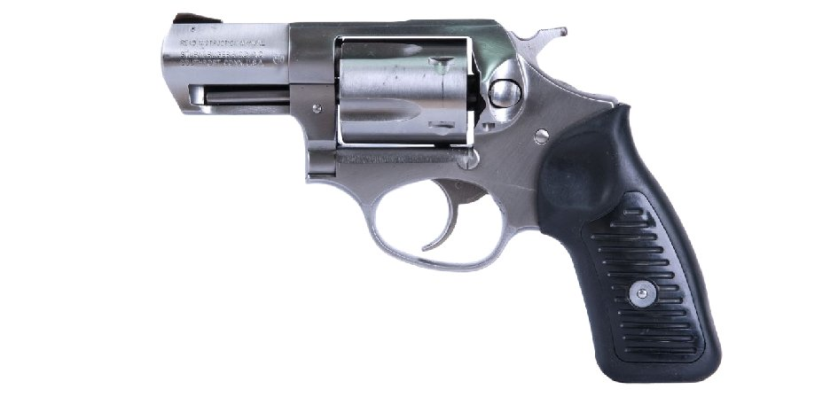

**Brokové zbraně (hladký vývrt):**

- **Jednuška:** jednohlavňová jednoranová brokovnice.
- **Dvojka:** dvouhlavňová brokovnice s hlavněmi **vedle sebe**.
- **Lankasterka:** dvojka s **vnějšími kohouty**.
- **Hamerleska:** dvojka se sklopnými hlavněmi a **skrytými** kladívky.
- **Broková kozlice:** dvě brokové hlavně **nad sebou**.

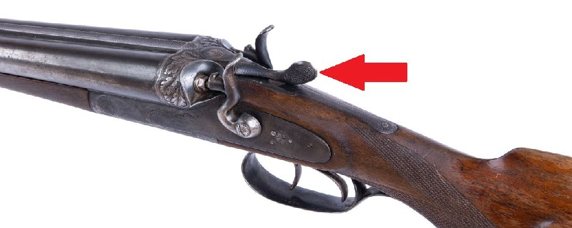

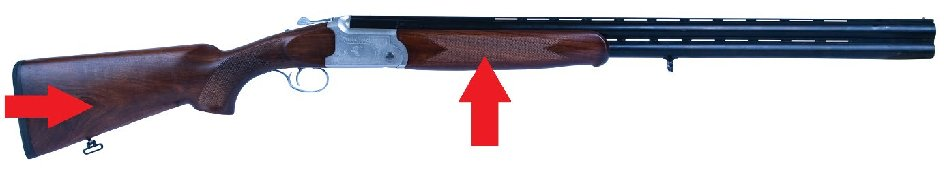

Většina těchto zbraní má **lůžkový závěr a sklopný hlavňový svazek**. Hlavně se „zlomí“ dolů a otevírají se **temenní kličkou** na horní straně.

**Kulové zbraně (drážkovaný vývrt):**

- **Kulovnice:** jednohlavňová, obvykle lovecká dlouhá zbraň pro kulové náboje.
- **Dvoják:** dvě kulové hlavně **vedle sebe**.
- **Kulová kozlice:** dvě kulové hlavně **nad sebou**.

**Kombinované zbraně:**

- **Kombinovaná zbraň:** lovecká dlouhá zbraň se dvěma a více hlavněmi s **různým vývrtem**.
- **Kulobroková kozlice:** dvě hlavně nad sebou, jedna kulová a jedna broková.

**Pomůcka:** „vedle sebe“ = dvojka (broky) nebo dvoják (kule), „nad sebou“ = kozlice.

**Flobertka:** krátká nebo dlouhá zbraň pro náboje typu **Flobert** (část 7). U dlouhých flobertek je častý hladký vývrt.

**Historické konstrukce:**

- **Perkusní revolver:** nabíjí se zepředu do komor válce černým prachem a **děleným střelivem** (prach, střela a zápalka zvlášť). Zapaluje se **perkusními zápalkami**, které se ručně nasazují na **pistony** vzadu na válci. Iniciaci zajistí úder kladívka (kohoutu) na perkusní zápalku.
- **Zbraň s křesadlovým zámkem:** nabíjí se ústím hlavně černým prachem, prach zapálí jiskra z křesadla.

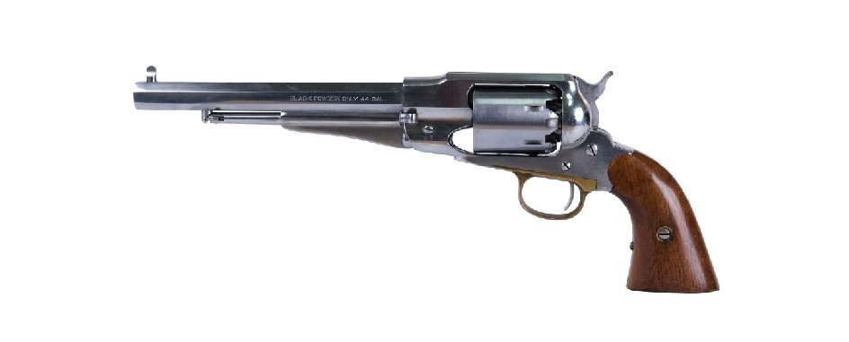 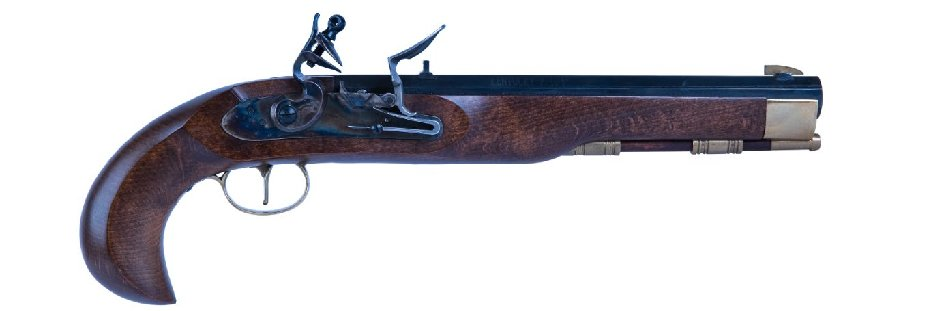

Otázky: 681, 682, 688, 689, 690, 691, 692, 693, 694, 695, 742, 743, 744, 745, 746, 747, 748, 749, 750, 751, 752, 753, 754, 761

## 6. Zbraně na obrázcích

V testu se objevují stejné obrázky zbraní, u kterých se ptá na čísla nebo šipky. Pomůže znát typickou stavbu:

**Samonabíjecí pistole** (s odnímatelným zásobníkem a pevnými mechanickými mířidly): nahoře **závěr** s **výhozným okénkem**, ve kterém je vidět hlaveň s nábojovou komorou. Pod ním **hlaveň** (u uzamčených pistolí s uzamykacími ozuby a odemykací kulisou), **vratná pružina s vodítkem**, dole **tělo** s rukojetí, ve které je **zásobník**, a **lučík** se spouští. Zásobník je v rukojeti (otázka se ptá, kterými čísly je jeho umístění označeno).

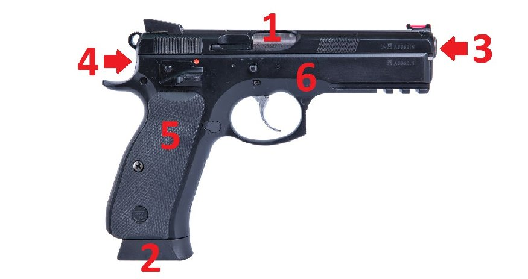 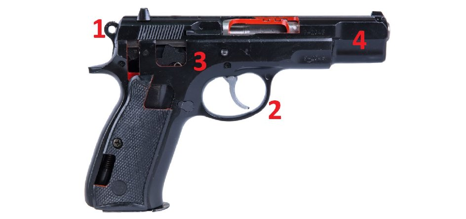

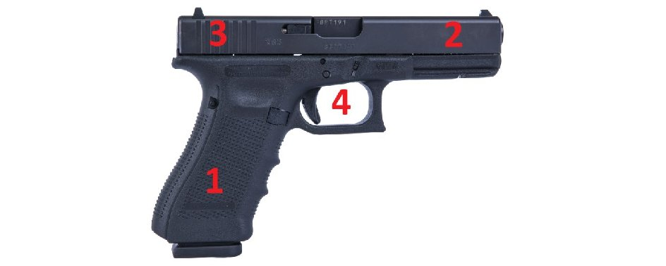

**Revolver:** **rám**, **válec** (hlavní část zbraně), **výklopná konzole válce**, na které se válec vyklápí do strany, a **vnější bicí kohout** vzadu.

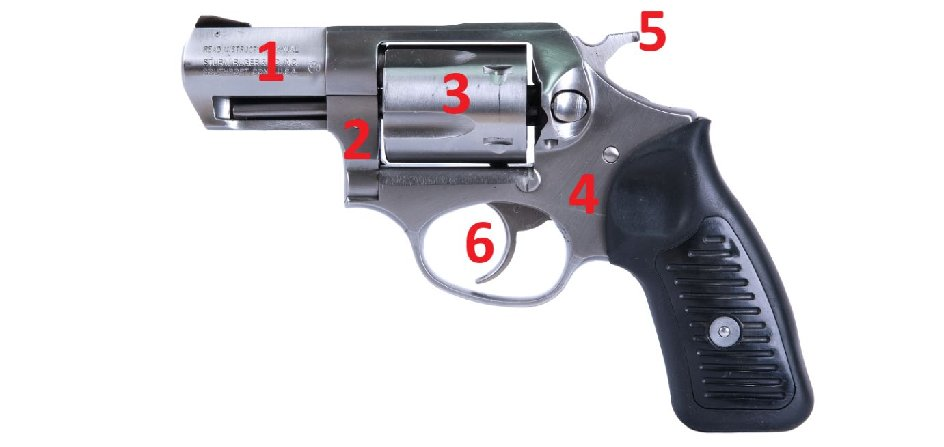

**Havárie revolveru:** Když se revolver při výstřelu roztrhne, je na první pohled poškozený **rám a válec**. Příčinou může být **rážově nepříslušné střelivo** nebo **výstřel při ucpané hlavni** nebo ústí komory, třeba kvůli střele uvízlé po předchozí slabé ráně.

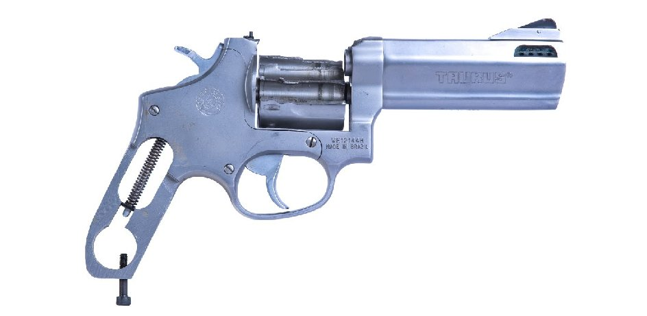

**Opakovací dlouhá zbraň** (např. malorážka): pažba, lučík, spoušť, **klika závěru**, závěr, ovládání (hmatník) pojistky, pouzdro závěru, výhozné okénko, hlaveň, hledí, dno zásobníku. Směr k ústí hlavně je směr, kterým střela opouští zbraň. Opačný směr míří k rameni střelce.

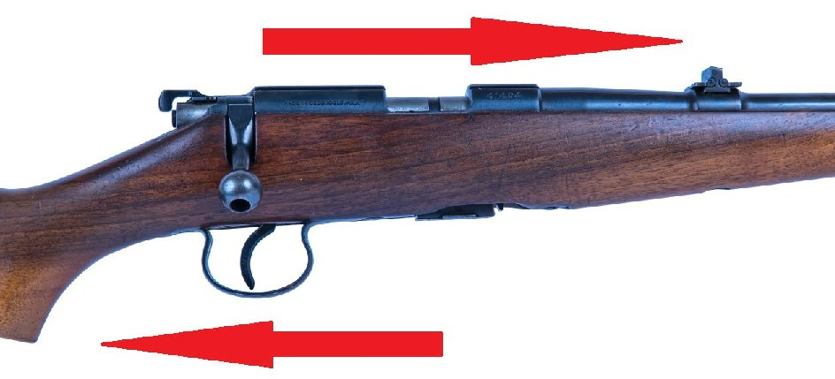

**Šipky u náboje:** šipka „dopředu“ ukazuje směr, kterým se náboj **zasouvá** do nábojové komory. Šipka „dozadu“ ukazuje směr, kterým se náboj nebo nábojnice **vytahuje** ven.

Otázky: 679, 680, 683, 684, 685, 686, 687, 697, 698, 699, 710, 711, 712, 713, 714, 674, 676

## 7. Střelivo

**Kulový náboj** se skládá ze čtyř částí: **nábojnice, střela (projektil), prachová (výmetná) náplň a zápalka**. U jednotného kulového náboje je to všechno spojené v jeden celek.

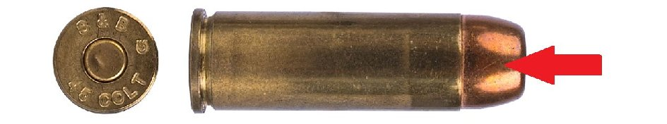

**Zápalka** obsahuje zápalkovou slož, která se úderem (nebo jinak) vznítí a **zažehne výmetnou náplň**.

**Podle zápalu** se střelivo s mechanickým zápalem dělí na:

- **okrajový zápal**: zápalková slož je v okraji dna nábojnice. Typicky **.22 Long Rifle** a **Flobert**,
- **středový zápal**: zápalka uprostřed dna nábojnice. Většina pistolových a puškových nábojů,
- **zápal Lefaucheux**: historický, se zápalným kolíkem.

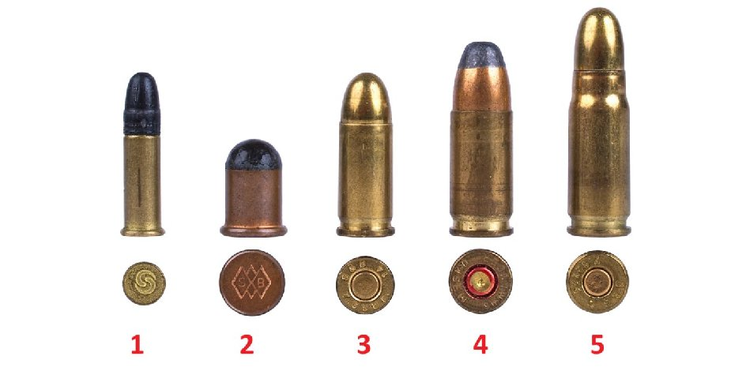

**Náboj Flobert** má okrajový zápal a jednotnou nebo hromadnou střelu, obvykle v rážích 4, 6 nebo 9 mm.

**Školní (vybíjecí) náboj** nemá výmetnou náplň ani zápalku, ale rozměrově odpovídá skutečnému náboji. Slouží k výcviku nabíjení a spouštění zbraně a ke kontrole funkce zásobníku, závěru a spouště. Používá se i u praktické části zkoušky.

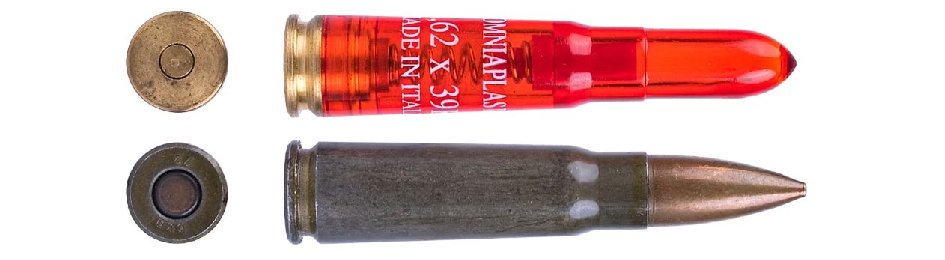

**Tvar a dno nábojnice:**

- **lahvovitá** nábojnice se před střelou zužuje (typicky puškové náboje),
- nábojnice **s okrajem** (vyčnívající okraj dna, např. .22 LR, 9 mm Flobert, 7,62 × 54 **R**, kde „R“ znamená *rimmed*, s okrajem),
- nábojnice **s drážkou** (drážka nad dnem, např. 9 mm Luger, 7,5 × 55 Swiss),
- **polookraj** (semi-rim) má např. 7,65 mm Browning.

**Typy střel:** **poloplášťová** střela má plášť jen zčásti a olověné jádro je na špičce odkryté (v testu náboj 9 mm Luger).

**Typičtí zástupci:** 7,65 mm Browning a 9 mm Luger = náboje pro **krátké samonabíjecí** kulové zbraně. 7,5 × 55 Swiss a 7,62 × 54 R = náboje pro **dlouhé zbraně s drážkovaným vývrtem** (pušky, kulovnice). Byly původně vojenské a pokud odpovídají požadavkům zákona o ověřování zbraní a střeliva, lze je použít i třeba ke sportovní střelbě. 7,62 × 39 = vojenský náboj **středního balistického výkonu**, dnes častý i ve sportu.

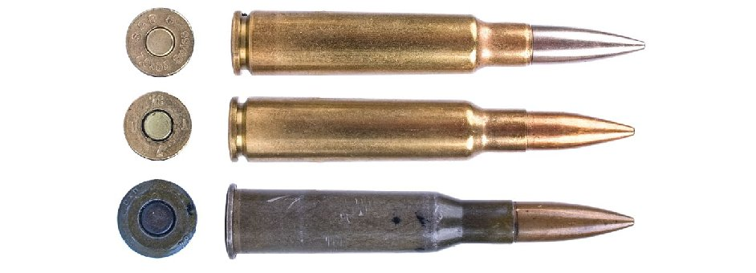

**Brokový náboj:**

- **zápalka** ve dnu iniciuje (zažehne) výmetnou prachovou náplň,
- **kování** je kovová část u dna nábojnice,
- místo broků může mít **jednotnou střelu**, např. typu **Brenneke**,
- číslo na nábojnici, např. **„67,5“**, udává **minimální délku nábojové komory**, ve které lze náboj bezpečně použít,
- **Pozor na ráže 12 a 20:** náboj ráže 20 vložený omylem do brokovnice ráže 12 může propadnout a zachytit se okrajem v přechodovém kuželu vývrtu. Když pak střelec vloží náboj ráže 12 a vystřelí, zbraň se s vysokou pravděpodobností **roztrhne**. Proto mívají náboje ráže 20 **žlutou** nábojnici.

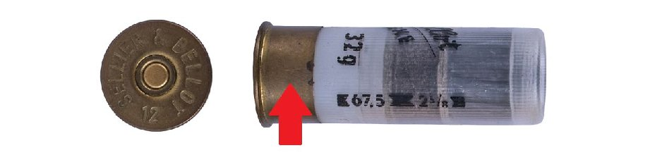 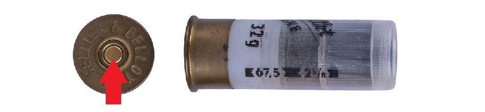

Otázky: 649, 650, 651, 652, 653, 654, 655, 657, 658, 659, 660, 661, 663, 664, 665, 667, 668, 669, 671, 672, 673, 675, 758, 759, 760, 774

## 8. Balistika: jak daleko a s jakým účinkem

**Záměrná** je přímka spojující mířidla zamířené zbraně a záměrný bod na cíli.

**Maximální dostřel** je největší vzdálenost, na kterou střela z dané zbraně s daným střelivem vůbec doletí. **Účinný dostřel** je největší vzdálenost, na kterou lze mířenou střelbou efektivně vyřadit zvolený cíl. Maximální dostřel je vždy mnohem větší, a právě proto je nutné vědět, co je za cílem (kapitola 3).

Orientační čísla, která se v testu objevují:

- **pistole 9 mm Luger** a podobné ráže: maximální dostřel **i přes 1,5 km**, vážné až smrtelné poranění po **více než polovinu** dráhy letu,
- **.22 Long Rifle**: **přes 1,5 km**, vážná újma po zhruba **dvě třetiny** dráhy. Malá ráže neznamená malé nebezpečí,
- obecně u malých pistolových a malorážkových nábojů: zhruba **1 500 m a víc**, smrtící účinek minimálně do 1 000 m. Podstatně méně má jen slabý **9 mm Flobert**,
- **7,62 × 39**: zhruba **2 800 m**, smrtící účinek **po celé dráze**,
- **.308 Winchester** a podobné ráže: **až 4 km**, vážná újma po celé dráze,
- **7,5 × 55 Swiss / 7,62 × 54 R**: úsťová rychlost asi **780 m/s**, úsťová energie asi **3 500 J**, maximální dostřel asi **4 000 m**,
- **broky 2,4–3,5 mm** z brokovnice ráže 12 nebo 16: **stovky metrů**. Pomůcka: dostřel v metrech ≈ **100 × průměr broku v mm** (broky 2,4 mm ≈ 240–250 m),
- **hrubé broky („buck shot“, např. 8,43 mm)**: pravidlo stonásobku **neplatí**, dostřel je srovnatelný s menšími kulovými střelami, **přes 1 000 m**.

**Krytí brokovnice** je procento broků, které zasáhnou kruhový zkušební terč v určené vzdálenosti, z celkového počtu broků v náboji. Ovlivňuje ho zahrdlení (část 1).

**Ranivý účinek** je ničivý účinek střely na živý cíl, jehož výsledkem je střelné poranění. **Průbojný účinek** je schopnost střely pronikat cílem.

Otázky: 662, 666, 670, 762, 763, 764, 765, 766, 767, 768, 769, 770, 771, 772

## 9. Havárie, ověřování a úpravy zbraní

**Vydutí hlavně** je místní zvětšení průměru hlavně při výstřelu. Jde o **havárii zbraně**, typicky po výstřelu s překážkou v hlavni.

**Zkušební značky** dokládají, že zbraň prošla ověřením:

- **česká státní zkušební značka** znamená, že zbraň ověřila státní autorita v České republice. Od roku 2000 je to **Český úřad pro zkoušení zbraní a střeliva**,
- **jednotná zkušební značka podle úmluvy C.I.P.** (Úmluva o vzájemném uznávání zkušebních značek ručních palných zbraní) dokládá ověření tzv. **obyčejnou zkouškou** a je uznávaná v členských státech úmluvy,
- speciální značka u brokové zbraně může dokládat, že zbraň je ověřená pro střelbu **ocelovými broky**. Bez ní ocelové broky nepoužívejte.

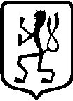 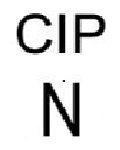 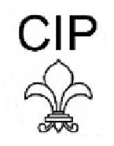

**Nevratné úpravy:** zbraň může být upravena např. **zhotovením řezu**. Rozříznutá zbraň ukazuje vnitřní mechanismus, slouží k výuce a vystřelit z ní nejde.

**Munice:** předmět vojenského charakteru, jako granát, mina nebo dělostřelecký náboj, není střelivo, ale **munice** podle **zákona o munici**. Na nalezenou munici nesahejte a volejte policii.

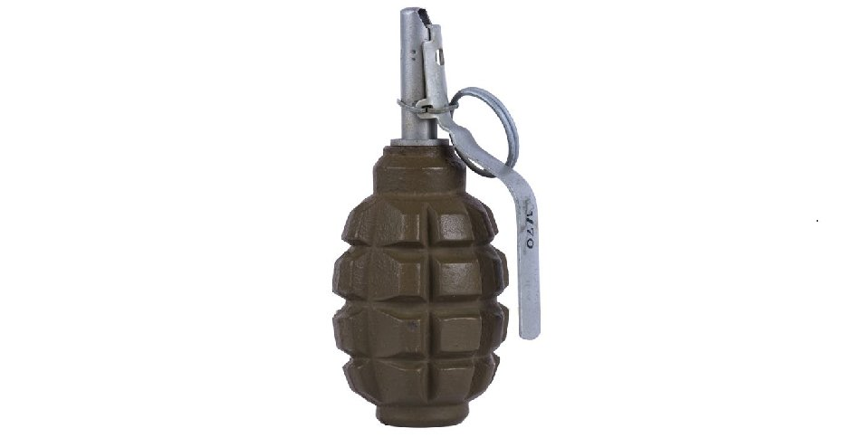

Otázky: 677, 678, 715, 716, 717, 773

## 10. Střelnice

- **Střelecké stanoviště**: přesně určené, případně ohrazené místo, ze kterého se střílí.
- **Palebná čára**: omezuje střelecká stanoviště směrem **k terčové čáře**. Za ni se při střelbě nevstupuje.
- **Cílový prostor**: prostor, kde je umístěn terč a terčová zařízení.
- **Terčové zařízení**: zařízení k umístění a případnému pohybu terčů.
- **Nástřelná série**: série k ověření nastřelení a funkce zbraně, zpravidla před soutěží.

Otázky: 775, 776, 777, 778, 779

## Shrnutí do kapsy

1. Drážkovaný (i polygonální) vývrt střelu roztáčí, hladký je pro broky.
2. Broková ráže: menší číslo = větší ráže. Ráže 20 do dvanáctky nikdy (žlutá nábojnice).
3. Hlavní části zbraně: hlaveň, závěr, tělo/rám, u revolveru válec. Pružina ani zásobník ne.
4. Vedle sebe = dvojka/dvoják, nad sebou = kozlice. Lankasterka = vnější kohouty, hamerleska = skryté kohouty.
5. Okrajový zápal = .22 LR a Flobert. Školní náboj = bez prachu a zápalky.
6. Pistole i malorážka dostřelí přes 1,5 km, puška až 4 km. Broky ≈ 100 × průměr broku v mm.
7. Vydutí hlavně = havárie. C.I.P. = mezinárodně uznávaná zkušební značka.
